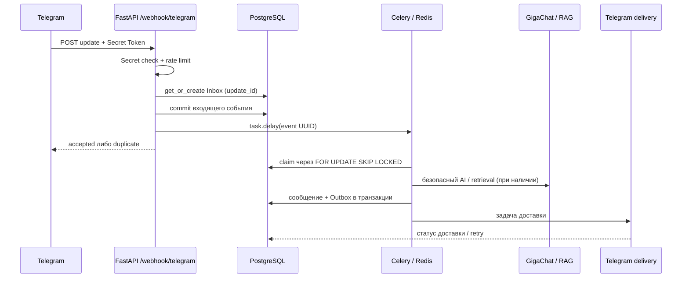

# TATTOTOYOU — демонстрация событийного контура

Материал основан на [FastAPI webhook](../src/app/api/webhooks/telegram.py), [тесте конкурентного Inbox](../tests/integration/test_incoming_event_inbox.py), [проверке Telegram-безопасности](../tests/unit/test_telegram_security.py) и [исходной архитектуре](../README.md). Это **воспроизводимый тестовый сценарий**, а не запись обработки реального клиента или обещание непрерывной production-эксплуатации.

## Сквозной поток



На входе Webhook подтверждает секрет и ограничивает частоту запросов **до** постановки в очередь. Входящее событие сохраняется в PostgreSQL до обращения к Redis, поэтому ошибка брокера не уничтожает запись: планировщик повторно подберёт её.

## Что можно проверить без живого Telegram

| Сценарий | Проверка | Ожидаемое поведение |
|---|---|---|
| Неверный webhook-secret | тесты webhook security | `403`, бизнес-обработка не выполняется |
| Повторный `update_id` | `IncomingEventRepository.get_or_create` | Одна запись Inbox, ответ `duplicate` при повторном приёме |
| 20 конкурентных попыток принять событие | `test_incoming_event_is_created_once_and_claimed_once` | Один идентификатор события и один успешный claim |
| 20 конкурентных записей бизнес-эффекта | `test_message_business_effect_is_created_once_under_concurrency` | Одно входящее сообщение |
| Сбой Telegram HTTP API | `test_telegram_http_errors_do_not_expose_bot_token` | Токен отсутствует в логируемой ошибке |
| Исходящая доставка | [тесты Outbox](../tests/integration/test_outbound_delivery.py) | Повторы/статусы по установленным правилам |

В интеграционных проверках используется **выделенная тестовая PostgreSQL** с миграциями и pgvector. Нельзя запускать команды очистки тестовой БД против рабочей БД проекта.

### Локальные команды проверки

Для unit-проверки без внешних сервисов:

```bash
uv sync --locked --extra dev
uv run --locked --extra dev python -m pytest -q tests/unit/test_telegram_security.py
```

Для полной интеграционной проверки с PostgreSQL и Redis используется документированный runner:

```bash
uv run --no-sync python scripts/run_postgres_integration.py
```

Runner управляет отдельной **тестовой** БД, поэтому его следует запускать только после проверки настроек подключения и без доступа к production.

## Честные ограничения

- PostgreSQL обеспечивает идемпотентность записи события и бизнес-эффекта, но Telegram `sendMessage` не поддерживает внешний idempotency-key. При падении после отправки и до commit статуса `sent` **возможна повторная отправка**.
- CI и mock-тесты подтверждают оговорённые сценарии, а не uptime, количество реальных клиентов или успешное production-внедрение.
- Здесь намеренно отсутствуют реальные webhook-токены, Chat ID, переписки клиентов и обращения к живому LLM API.

[Тестирование и quality gates](../README.md#тестирование-и-quality-gates) · [Ограничения и roadmap](../docs/PRODUCTION_ROADMAP.md)
